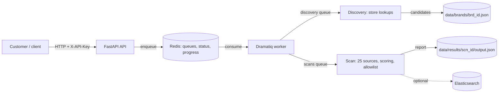

# Rogue App Scanner

Finds mobile apps that impersonate a brand. A customer gives a brand name and one or two store links. The scanner finds the brand's own apps, asks the customer to confirm them, then searches app stores, APK sites, web search and code hosts for other apps that copy the brand. Each hit is scored, and the report lists the likely rogue apps.

The API queues each scan. A Dramatiq worker runs it. Redis holds the queue and live progress.

---

## Contents

1. [Scope](#1-scope)
2. [Architecture](#2-architecture)
3. [End-to-end flow (YONO SBI example)](#3-end-to-end-flow-yono-sbi-example)
4. [Customer inputs](#4-customer-inputs)
5. [Scoring](#5-scoring)
6. [Allowlist](#6-allowlist)
7. [Sources](#7-sources)  
8. [Keyword expansion](#8-keyword-expansion)
9. [Report structure](#9-report-structure)
10. [Configuration](#10-configuration)
11. [Known limitations](#11-known-limitations)
12. [Latest SBI results](#12-latest-sbi-results)
13. [Development](#13-development)

---

## 1. Scope

**What it does**

- Finds a brand's own apps from one or two store links and lists them for the customer to confirm.
- Searches 25 sources for apps and pages that use the brand name, aliases or lure words.
- Scores every hit, clears the brand's own confirmed apps, and reports what is left.

**What it does not do**

- It does not take anything down. The report is the output.
- It does not download or analyse APKs in the MVP. A code path exists behind `analyze_apks`, which is off by default.
- It does not monitor the dark web or social media. Telegram is searched only through a public web index.
- It does not check threat-intelligence feeds. The API keys for them are in the settings, but no source uses them.

**Users:** brand protection teams at companies that publish mobile apps.

**Scope of the MVP:** metadata only (store listings, search results and pages). English-language search terms, plus the localized phrases listed in `config/phrases.yaml`. Scans cover all configured storefronts (see [Configuration](#10-configuration)).

---

## 2. Architecture



| Component | Location | Role |
|---|---|---|
| API | `app/main.py`, `app/api/routes/` | Validates requests, queues discovery and scans, serves status and reports |
| Worker | `app/jobs/actors.py` | Runs discovery (`discovery` queue) and scans (`scans` queue) |
| Discovery | `app/services/discovery.py` | Reads store listings for a brand and returns candidate apps |
| Brand store | `app/services/brand_store.py` | Brand records as JSON files under `data/brands/` |
| Sources | `app/sources/` | One adapter per source, registered in `registry.py` |
| Orchestrator | `app/services/orchestrator.py` | Runs the sources, dedups, scores, allowlists, builds the report |
| Scoring | `app/services/scoring.py`, `config/scoring.yaml` | Relevance score per hit |
| Allowlist | `app/services/allowlist.py` | Clears the brand's own apps |
| Keyword expansion | `app/services/keyword_expansion.py`, `config/phrases.yaml` | Search terms from the brand name |
| Rate limiter | `app/utils/rate_limiter.py` | Per-host sliding window in Redis |
| Elasticsearch | `app/storage/es_store.py` | Optional copy of scans and hits |

### Queues

| Queue | Consumer | Used for |
|---|---|---|
| `scans` | worker | Scan jobs |
| `webhooks` | worker | Webhook delivery |
| `discovery` | worker | Brand discovery jobs |

Both the API (embedded worker, when `EMBEDDED_WORKER=true`) and `run.py` start a worker that consumes all three queues.

---

## 3. End-to-end flow (YONO SBI example)

The example brand is YONO SBI, the mobile banking app of State Bank of India. All ids, counts and responses below come from real runs.

```
 1. POST /v1/brands/discover        -> 202 {brand_id, status: queued}
 2. worker: discovery job            (Play listing, developer page, App Store seller, name search)
 3. GET  /v1/brands/{brand_id}      -> status done, candidates[], notes[]
 4. POST /v1/brands/{brand_id}/confirm   -> 200 {confirmed[]}
 5. POST /v1/scans  (brand_id)      -> 202 {scan_id}
 6. worker: scan job                 (sources, dedup, scoring, allowlist, threshold)
 7. GET  /v1/progress/{scan_id}     -> status, progress   and   data/results/<scan_id>/output.json
```

### Step 1: start discovery

```http
POST /v1/brands/discover
X-API-Key: <key>
Content-Type: application/json
```

```json
{
  "brand_name": "YONO SBI",
  "aliases": ["YONO"],
  "country": "in",
  "play_store_url": "https://play.google.com/store/apps/details?id=com.sbi.lotusintouch",
  "app_store_url": "https://apps.apple.com/in/app/yono-sbi-bangladesh/id1556426905",
  "official_domains": ["onlinesbi.sbi"]
}
```

| Field | Required | Rule |
|---|---|---|
| `brand_name` | yes | 1 to 200 characters |
| `play_store_url` | one of the two store links | Must be a Play details link with an `id` parameter. Otherwise 422. |
| `app_store_url` | one of the two store links | Must be an App Store link with an `/id<number>` path. Otherwise 422. |
| `aliases` | no | Other names for the brand. Up to 20. |
| `official_domains` | no | Brand domains. Up to 20. |
| `country` | no | Two letters, default `in`. Used for the store lookups in discovery. |

- Sending neither store link returns 422 with "give play_store_url, app_store_url or both".
- `sibling_brands` is refused with 422. It was removed.

Response, 202:

```json
{"brand_id": "brd_01M684F1HBG8A15AB3EJ3AVBM7", "status": "queued"}
```

The request is saved to `data/brands/<brand_id>.json` and a job is queued. The request returns straight away.

### Step 2: discovery job (worker)

The job runs in `app/services/discovery.py`. Each source gives candidates. Candidates are then deduplicated on (store, id).

**Google Play (from `play_store_url`)**

1. Read the listing for the package id in the link. The listing gives the developer name (`State Bank of India`) and the developer id (`State+Bank+of+India`).
2. Read the developer page `https://play.google.com/store/apps/developer?id=<developer id>&hl=en&gl=in` and take every `details?id=` link on it. The SBI run returned 20 packages. The page is limited to its first 20 apps (see [Known limitations](#11-known-limitations)).
3. Read each package's listing (3 at a time).

**App Store (from `app_store_url`)**

1. Read the app with the iTunes lookup. The app's `artistId` is the seller id.
2. Read every software item of that seller with `itunes.apple.com/lookup?id=<artistId>&entity=software`. The SBI run returned 28 apps.

If there is no App Store link, the job searches the App Store for sellers whose name equals the Play developer name. A name match only, so the customer must check those apps.

**Name search (both stores)**

For each brand term (the brand name and each alias) the job searches Google Play (up to 30 results; in practice about 12 to 15 per storefront) and the App Store. A result is kept only if its title contains a brand term. Results from this search are never pre-selected.

**Pre-selection and notes**

- A listed app or seller app is pre-selected (`default: true`) when its name contains the brand name or an alias.
- Search results are not pre-selected (`default: false`).
- `notes` records what could not be read, for example "the Google Play search for 'YONO' could not be read" or "the Play developer page may not list every app of the developer".

Discovery on SBI with both links and the alias `YONO` returned 58 candidates: 23 Play and 35 App Store, after the name search added its hits to the 20 Play and 28 App Store listed apps. 30 were pre-selected.

### Step 3: check discovery status

```http
GET /v1/brands/brd_01M684F1HBG8A15AB3EJ3AVBM7
X-API-Key: <key>
```

`status` goes `queued` → `running` → `done`, or `failed`.

```json
{
  "brand_id": "brd_01M684F1HBG8A15AB3EJ3AVBM7",
  "status": "done",
  "error": null,
  "play_developer": "State Bank of India",
  "play_developer_id": "State+Bank+of+India",
  "candidates": [
    {
      "store": "play",
      "id": "com.sbi.lotusintouch",
      "name": "YONO SBI: Banking, UPI & Pay",
      "publisher": "State Bank of India",
      "icon": "https://play-lh.googleusercontent.com/...",
      "url": "https://play.google.com/store/apps/details?id=com.sbi.lotusintouch",
      "default": true
    },
    {
      "store": "app_store",
      "id": "com.sbi.YONOBD",
      "name": "YONO SBI Bangladesh",
      "publisher": "State Bank of India",
      "icon": "https://is1-ssl.mzstatic.com/...",
      "url": "https://apps.apple.com/in/app/yono-sbi-bangladesh/id1556426905?uo=4",
      "default": true
    }
  ],
  "notes": [
    "the Play developer page may not list every app of the developer"
  ],
  "confirmed": [],
  "confirmed_at": null
}
```

`candidates` has one entry per app. Entries are shown above in full; the real response has 58 entries for SBI.

### Step 4: customer confirmation

```http
POST /v1/brands/brd_01M684F1HBG8A15AB3EJ3AVBM7/confirm
X-API-Key: <key>
Content-Type: application/json
```

```json
{
  "confirmed_by": "ops@customer.example",
  "selected": [
    {"store": "play", "id": "com.sbi.lotusintouch"},
    {"store": "app_store", "id": "com.sbi.YONOBD"}
  ]
}
```

| Rule | Result |
|---|---|
| Brand not found | 404 |
| Discovery not `done` | 409 |
| An item is not a candidate (store and id must both match) | 422, the request is rejected |
| Valid request | 200 with the saved list |

- Confirming again replaces the previous list.
- Each saved item keeps `store`, `id`, `name`, `publisher`, `confirmed_by` and `confirmed_at`. This is the audit trail.
- Only confirmed items are used by scans.

Response, 200:

```json
{
  "brand_id": "brd_01M684F1HBG8A15AB3EJ3AVBM7",
  "status": "done",
  "confirmed_at": "2026-10-31T06:52:10.114203+00:00",
  "confirmed": [
    {
      "store": "play", "id": "com.sbi.lotusintouch", "name": "YONO SBI: Banking, UPI & Pay",
      "publisher": "State Bank of India", "confirmed_by": "ops@customer.example",
      "confirmed_at": "2026-10-31T06:52:10.114203+00:00"
    }
  ]
}
```

### Step 5: start a scan

```http
POST /v1/scans
X-API-Key: <key>
Content-Type: application/json
```

```json
{
  "brand_name": "YONO SBI",
  "brand_id": "brd_01M684F1HBG8A15AB3EJ3AVBM7",
  "official_domains": ["yonoretail.sbi.bank.in"]
}
```

**What happens before the scan runs**

1. The API loads the brand. Unknown brand: 404. Brand not confirmed: 409.
2. The request is saved as sent. This becomes the report's `query`.
3. The confirmed brand data is merged into the request:

| Brand data | Goes to the scan request as |
|---|---|
| Confirmed Play ids | `android_packages` |
| Confirmed App Store ids | `ios_bundles` |
| Publisher names of the confirmed apps | `official_publishers` |
| Aliases | `brand_aliases` |
| Domains from discovery | `official_domains` (added to the ones you send) |

4. An identical request that is still queued or running returns the existing scan instead of starting another. The check uses a hash of the merged request.
5. If the queue is full (`max_queue_depth`), the API returns 429.

Response, 202:

```json
{"scan_id": "scn_01M68BXR0V087DGN1HREJXE7XW", "message": "Job queued"}
```

### Step 6: scan execution

Each step runs in the worker, in `app/services/orchestrator.py`.

1. **Keyword expansion.** Search terms are built from the brand name and aliases (see [section 8](#8-keyword-expansion)). The SBI run had 48 terms.
2. **Sources.** All 25 sources run in parallel. Each one returns hits and a status (`ok`, `failed`, `blocked` or `skipped`).
3. **Deduplication.** Hits with the same URL are merged. Each hit keeps every query and source that found it.
4. **Scoring.** Each hit is scored from 0 to 100 (see [section 5](#5-scoring)).
5. **Allowlist.** A hit that matches a confirmed publisher and one of the brand's own ids on the same platform is moved to `allowlisted` with a reason (see [section 6](#6-allowlist)).
6. **Threshold.** Hits under 35 are moved to `suppressed`. Hits from social and web-search sources need 40.
7. **Classification.** Scores of 70 and up are high risk. Hits from 35 to 69 are for review.
8. **Report.** The report is written to `data/results/<scan_id>/output.json`. If Elasticsearch is configured, the scan and hits are also indexed there. Indexing failures are logged as warnings and do not fail the scan.

### Step 7: read the report

```http
GET /v1/progress/scn_01M68BXR0V087DGN1HREJXE7XW
X-API-Key: <key>
```

The progress endpoint gives status and per-source progress. It does not include the report.

```json
{
  "scan_id": "scn_01M68BXR0V087DGN1HREJXE7XW",
  "status": "completed_with_errors",
  "brand_name": "YONO SBI",
  "created_at": "2026-10-31T07:04:02Z",
  "started_at": "2026-10-31T07:04:03Z",
  "finished_at": "2026-10-31T07:05:20Z",
  "overall_progress": 100,
  "sources": [{"name": "itunes", "status": "ok", "results": 405}]
}
```

The report is read from `data/results/<scan_id>/output.json`. Its structure is in [section 9](#9-report-structure). Status values: `queued`, `running`, `completed`, `completed_with_errors` (some sources failed, the report is still complete), `failed`.

Other endpoints:

| Method | Path | Purpose |
|---|---|---|
| `DELETE` | `/v1/scans/{scan_id}` | Delete a scan. Returns 409 while it is running. |
| `GET` | `/health` | Checks the API and Redis. Returns `{"status":"ok","redis":"ok"}`. |

---

## 4. Customer inputs

**Customer provides**

| Input | Required | Where |
|---|---|---|
| Brand name | yes | `brand_name` |
| At least one store link | yes | `play_store_url` or `app_store_url` (both allowed) |
| Official domains | recommended | `official_domains` at discovery and scan |
| Aliases | no | `aliases` at discovery |
| Confirmation of the discovered app list | yes, before a scan with `brand_id` | `POST /v1/brands/{id}/confirm` |

Brand logos are not an input yet. Icon comparison is in the scoring code, but the scan does not use a logo supplied by the customer.

**The system finds these itself; the customer never types them**

- Package ids and bundle ids of the brand's apps (from the store links and the seller and developer lookups).
- Publisher and developer names (from the listings).
- The other apps of the same developer or seller (from the developer page and the seller lookup).

**Removed inputs**

- `sibling_brands`: refused with 422.
- `android_package` and `ios_bundle` on a scan: refused with 422. Use `android_packages` and `ios_bundles`.
- `countries` on a scan: refused with 422. Scans search the storefronts from settings (see [section 10](#10-configuration)).

---

## 5. Scoring

### Approach

Each hit starts at 0. Signals add or subtract points. The score is capped in a few cases. The final value is rounded and clamped to 0 to 100.

Scoring is deterministic. Weights and signal values are in `config/scoring.yaml`. `ruleset_version` is `v9`, and the report carries it as `summary.scoring_ruleset`. Change the ruleset version when weights or signals change.

### Weights

| Weight | Value | Signal |
|---|---|---|
| `name_similarity` | 0.30 | Title or app name against the brand name, fuzzy, on folded text |
| `package_similarity` | 0.25 | Package id against the brand's official package ids |
| `domain_similarity` | 0.15 | Registrable domain against the official domain |
| `publisher_match` | 0.10 | Publisher name against the brand name |
| `apk_site_host` | 0.08 | Hit is on an APK distribution site |

A weight multiplies a similarity between 0 and 1, then by 100. For example, a package similarity of 0.90 adds `0.25 × 0.90 × 100 = 22.5` points.

### Signals

| Signal | Points | When |
|---|---|---|
| `scam_lure_keyword` | +6 | Brand matched exactly or fuzzily, and a scam word appears (`reward`, `kyc`, `login`, `bonus`, `loan`, `card`, `secure`, `account`, ...) |
| `brand_on_free_hosting` | +10 | Brand name in the subdomain of a free host (`web.app`, `herokuapp.com`, `pages.dev`, `github.io`, ...) |
| `lure_keyword_in_title` | +5 | Title contains `mod`, `cracked`, `premium`, `free`, `hack`, `cheat`, `unlocked`, `pro` or `lite` |
| `cert_mismatch_with_similar_pkg` | +15 | APK signing certificate differs from the official app's, and the package is a variant or the APK mentions the brand. Only used when APK analysis is on. |
| `package_id_suffix_variation` | +5 | Package id is similar to an official id but not equal to it |
| `official_store_name_clone` | +15 | Near-exact brand name on an official store, but not the official listing |
| `domain_jw_lookalike` | up to +12 | Lookalike registrable domain (Jaro-Winkler, scaled 0.85 to 1.0) |
| `domain_has_brand_plus_keyword` | +6 | Domain is the brand plus a keyword (`petpooja-apk.com`) |
| `tld_swap` | +4 | Same name, different TLD |
| `icon_phash_similar` | +10 | Icon similarity 0.80 or more (pHash) |
| `icon_phash_identical` | +20 | Icon similarity 0.95 or more |
| `permission_similarity_medium` | +8 | Permission overlap 0.60 or more with the official app (APK analysis only) |
| `repackaged_apk_bonus` | +15 | Permission overlap 0.85 or more and a certificate mismatch |
| `companion_app_penalty` | −15 | Utility or companion app for the brand (for example a status saver) |

### Caps

| Cap | Value | When |
|---|---|---|
| `no_brand_presence_cap` | 34 | No brand token (name, alias, package or publisher) matches. Keeps generic apps out. |
| `fuzzy_weak_brand_cap` | 44 | Only a loose spelling match, in two fields |
| `fuzzy_brand_cap` | 59 | Close spelling match (lookalike) |
| `unverified_official_copy_cap` | 55 | Same package as the official app on a third-party site. The certificate is not checked, so it is ranked below high risk. |
| `unsuspicious_page_cap` | 34 | Lookalike domain page that is parked, blank or neutral |

Brand presence uses the brand name and every alias. The strongest match counts. `YONO` as an alias makes "Yono Rummy Store" an exact match, so the 34 cap does not apply to it.

### Thresholds and risk bands

| Band | Score | Meaning |
|---|---|---|
| Suppressed | below 35 (below 40 for social and web search) | Not reported as a result. Kept in `suppressed` with the reason. |
| Review | 35 to 69 | Reported as a result for review |
| High risk | 70 and up | Reported as a result, flagged high risk |

### Walkthrough 1: "Yono Rummy Store" (aptoide, score 64)

Source: Aptoide. Publisher: not set. Package `com.yono_rummy`. Brand: `YONO SBI`, alias `YONO`.

1. **Presence.** The brand name "YONO SBI" does not match, because "SBI" is missing. The alias "YONO" matches as a whole word, so presence is `exact`. Without the alias, presence is absent and the hit is capped at 34 (this was the state before aliases were used in scoring).
2. **Name similarity.** Fuzzy match of "Yono Rummy Store" to "YONO SBI". The report says "resembles brand name", so this adds the name-similarity term.
3. **Lure and scam words.** "rummy" and "store" are not on the lists, so no lure or scam points.
4. **Host.** Aptoide is an APK site, so `apk_site_host` adds its weight (0.08).
5. **Result.** Score 64, above 35, so it is a result. It is not above the cap, so the cap did not apply.

The report gives the reasons but not the points per signal. That is a gap (see [section 11](#11-known-limitations)).

### Walkthrough 2: "YONO SBI Europe" (App Store, score 76, own brand, not confirmed)

Package `com.YONODEMobileApp`, publisher `State Bank of India`, host `app_store`.

1. **Presence.** Exact match on the brand name, so no cap.
2. **Name similarity.** "YONO SBI Europe" is close to "YONO SBI", so the name term adds points. The report says "resembles brand name".
3. **Package similarity.** The package is compared with every confirmed Android id. It is close to `com.YONOUKMobileApp` and the other `com.YONO*MobileApp` ids, so the package term is large, and the suffix-variation signal (+5) applies. The report says "closely matches official package" and "suffix variation".
4. **Official store.** It is on an official store but is not the official listing, so `official_store_name_clone` (+15) applies.
5. **Result.** Score 76, high risk.

This was a false positive. It is one of the brand's own apps, but the customer had not confirmed it, so it was not allowlisted. With the store-account rule ([section 6](#6-allowlist)) it is allowlisted when the brand has an App Store link (or an `ios_bundles` entry) whose seller is State Bank of India. In a live run on 2026-11-01 (both SBI links, alias `YONO`), it and 45 other State Bank of India apps on the two stores were allowlisted this way.

---

## 6. Allowlist

### The rule

**Store account.** A hit on Google Play or the App Store is allowlisted when the store says one of the brand's accounts publishes it:

- Google Play: the listing's developer id is in `play_developer_ids`.
- App Store: the listing's seller id (`artistId`) is in `app_store_seller_ids`.

The store issues these ids, and only the account owner can publish under one. So every app the brand's account publishes is cleared, including sibling apps the customer never confirmed and apps published after discovery. A copy that uses the same publisher *name* under another account is not cleared. The ids come only from Google Play and the App Store, never from a third-party site.

Where the account ids come from:

| Id | Source |
|---|---|
| `play_developer_ids` | The Play listing behind each of the brand's Play links (read at scan time), and the listing of `android_packages[0]` |
| `app_store_seller_ids` | The App Store listing behind each of the brand's App Store links, and any App Store hit whose bundle id is one of `ios_bundles` |
| Both | Can also be sent in the scan request |

Play search results show the developer name but not the id. Each Play hit that shows a brand publisher name is looked up on its listing to read the id (3 at a time, across the configured storefronts). Play hits under other publisher names are not looked up, because an account shows one name on all its apps.

Any other app hit is allowlisted only when **both** are true:

1. **Publisher.** The hit's publisher matches a confirmed publisher. Matching ignores case, punctuation and company suffixes (`Pvt`, `Ltd`, `Inc`).
2. **Package.** The hit's package id is one of the brand's confirmed ids on the **same platform**, or is in `allowlist_packages`.

A hit with a confirmed official domain is also allowlisted, on its own, when its registrable domain is in `official_domain` or `official_domains`.

### Platform

- App Store hits (`apps.apple.com`) are checked against the confirmed iOS bundle ids.
- Every other hit is checked against the confirmed Android package ids.

Package ids are unique per store only. A Play package id never clears an App Store hit, and an iOS bundle id never clears a Play hit. The same string can also belong to a different app on the other store.

### Why both checks

- **Publisher only is wrong.** Publisher names are self-declared on APK sites and can be copied. Anyone can publish under a famous developer's name.
- **Package only is wrong.** A package id can be re-uploaded by anyone on a site that does not check ownership, and the same id can be a different app on another store.
- **Both together** means a copy has to take the publisher and the package. It still needs the customer to confirm the id.

### Reasons

Each allowlisted entry includes a reason. Examples from the latest SBI scan:

```
package com.YONOUKMobileApp and publisher 'State Bank of India' match the declared app
package com.YONOMUApp and publisher 'State Bank of India' match the declared app
domain sbi.bank.in is an official domain
```

### Other allowlist inputs

| Setting | Use |
|---|---|
| `allowlist_packages` | Other ids the brand owns, for example a business app. Still needs a publisher match. |
| `official_publishers` | Publisher names. The confirmed publishers are added automatically. |
| `official_domains` | Other registrable domains owned by the brand. |

---

## 7. Sources

25 adapters are registered in `app/sources/registry.py`. Method is `API` (a documented JSON or RSS endpoint) or `scrape` (HTML or a site's search page).

Status in the table is from the latest SBI scan (`scn_01M68BXR0V087DGN1HREJXE7XW`). It can change from run to run.

| # | Source | Group | Method | Input | Returns | Limitations | Status (latest scan) |
|---|---|---|---|---|---|---|---|
| 1 | Apple App Store (`itunes`) | official store | API | Search terms, and seller lookup by `artistId` | `trackName`, `bundleId`, `artistName`, `trackViewUrl`, `artworkUrl60` | 200 results per query. Seller lookup lists all software of the seller. | ok, 405 results |
| 2 | Google Play (`google_play`) | official store | scrape (library) | Search terms, and package details | `appId`, `title`, `developer`, `icon` | Search returns about 12 to 15 results per storefront. Some apps are missing from some storefronts. | ok, 43 results |
| 3 | GetApps / Xiaomi (`getapps`) | official store | API | Search terms, per storefront | Name, package, publisher, icon | Storefront-specific results | ok, 38 results |
| 4 | Samsung Galaxy Store (`samsung_galaxy`) | official store | scrape (browser) | Search terms, per storefront | Name, URL, icon | Browser-rendered, slow | ok, 10 results |
| 5 | Huawei AppGallery (`huawei_appgallery`) | official store | scrape (browser) | Search terms | Name, URL, icon | Browser-rendered | ok, 0 results |
| 6 | Indus Appstore / PhonePe (`indus_appstore`) | official store | scrape | Search terms | Name, package, URL | Results are PhonePe's catalogue | ok, 10 results |
| 7 | TapTap (`taptap`) | third-party store | scrape | Search terms | Name, URL, icon | Global storefront only | ok, 0 results |
| 8 | F-Droid (`fdroid`) | open-source store | API | Index file, name match | Name, package, URL | Index is downloaded once per scan | ok, 6 results |
| 9 | Aptoide (`aptoide`) | APK site | API | Search terms | Name, package, publisher, URL | 36 results per scan | ok, 36 results |
| 10 | APKPure (`apkpure`) | APK site | scrape | Search terms | Name, URL | Returns HTTP 403 | blocked, 0 results |
| 11 | APKMirror (`apkmirror`) | APK site | RSS feed | Search terms | Name, URL | Feed may return 403 | ok, 0 results |
| 12 | APKCombo (`apkcombo`) | APK site | scrape | Search terms | Name, URL | DNS fails from the test machine | failed, DNS |
| 13 | APKFab (`apkfab`) | APK site | scrape | Search terms | Name, URL | Returns HTTP 403 | blocked, 403 |
| 14 | APK4Fun (`apk4fun`) | APK site | scrape | Search terms | Name, URL | Results may need the browser | ok, 0 results |
| 15 | APKKit (`apkkit`) | APK site | scrape | Search terms | Name, URL | Results may need the browser | ok, 1 result |
| 16 | APKBoat (`apkboat`) | APK site | scrape | Search terms | Name, URL | Plain HTTP | ok, 0 results |
| 17 | Softonic (`softonic`) | APK site | scrape | Search terms | Name, per-app subdomain URL | Returns HTTP 406 at times | blocked, 406 |
| 18 | HappyMod (`happymod`) | APK site | scrape (browser) | Search terms | Name, URL | DNS fails from the test machine | failed, DNS |
| 19 | Uptodown (`uptodown`) | APK site | scrape (browser) | Search terms | Name, URL | Browser-rendered | ok, 27 results |
| 20 | Bing (`bing`) | web search | scrape | Search templates, per storefront market | URL, title, snippet | Results vary between runs. Market changes results. | ok, 42 results |
| 21 | DuckDuckGo (`duckduckgo`) | web search | scrape | Search terms | URL, title, snippet | CAPTCHA when the IP is blocked | blocked, CAPTCHA |
| 22 | Lookalike domains (`lookalike_domains`) | domains | scrape | Generated domains from the official domain | Domain, page assessment | Needs `official_domain`. Only domains that resolve are reported. | ok, 0 results |
| 23 | GitHub (`github`) | code host | API | Search terms with `apk` | Repository name, URL | Rate limits without a token | ok, 0 results |
| 24 | GitLab (`gitlab`) | code host | API | Search terms | Repository name, URL | Rate limits without a token | ok, 0 results |
| 25 | Telegram (`telegram`) | social | scrape | Search terms through a public index, then public channel pages | Channel post text, links | Public channels only | ok, 0 results |

**Status key:** `ok` the source answered. `failed` an error (DNS, timeout, or parsing). `blocked` refused or challenged (HTTP 403 or 406, or a CAPTCHA). `skipped` not run (for example, Lookalike domains needs `official_domain`).

**Note on the list.** An earlier version of this README listed "Samsung Galaxy Store" and "Huawei AppGallery" as browser sources. Both are still browser sources. The browser is used only when plain HTTP returns no results.

**Rate limiting.** Every outgoing request goes through `throttle()` (`app/utils/http_client.py`), which uses the per-host Redis limiter. Default is 2 requests per second per host, with store and APK sites at 1 per second. A 429 is retried with `Retry-After` (up to 30 seconds). Downloads are disabled in the browser.

---

## 8. Keyword expansion

Keywords are built from the brand name and the aliases before the sources run. The latest SBI scan had 48 keywords.

| Type | Count | What it is | SBI examples |
|---|---|---|---|
| `original` | 3 | Brand name and its parts | `YONO SBI`, `YONO`, `SBI` |
| `variant` | 3 | Spacing and joining variants | `yono-sbi`, `yono_sbi`, `yonosbi` |
| `package` | 1 | Lower-case package-style token | `lotusintouch` (from `com.sbi.lotusintouch`) |
| `lure` | 24 | Brand plus a lure word, from the default phrases and the localized packs | `YONO SBI apk`, `YONO SBI mod apk`, `YONO SBI free download`, `YONO SBI cracked`, `YONO SBI loan app`, `YONO SBI تحميل`, `YONO SBI مهكر` |
| `typo` | 5 | Dropped or swapped letters | `ono sbi`, `yano sbi`, `oyno sbi`, `yyono sbi`, `tono sbi` |
| `homoglyph` | 5 | Look-alike Unicode characters | `yоno sbi` (Cyrillic о), `yóno sbi`, `yoиo sbi`, `yonо sbi`, `yonó sbi` |
| `package_guess` | 7 | Package ids guessed from the brand, for code and APK search | `com.yonosbi.app`, `com.yonosbi.billing`, `com.yonosbi.pro`, `com.yonosbi.lite`, `com.yonosbi.free`, `org.yonosbi.app`, `io.yonosbi.app` |

- Lure words for the default language are in `config/phrases.yaml` under `default.lure_suffixes`. Localized lure words come from the markets of the storefronts in settings.
- Keywords from the request (`keywords`) are added as well. None were sent for SBI.
- Homoglyph and typo variants are built from the brand name only, not from aliases.

---

## 9. Report structure

The report is `data/results/<scan_id>/output.json`. The latest SBI scan is `scn_01M68BXR0V087DGN1HREJXE7XW`.

### Top level

| Field | Type | Meaning |
|---|---|---|
| `scan_id` | string | `scn_` followed by a ULID |
| `query` | object | The request as the API received it, plus `analyze_apks` and `received_at`. Brand data merged from confirmation is not here. |
| `summary` | object | Counts (below) |
| `results` | array of Hit | Hits to review |
| `allowlisted` | array of AllowlistedItem | Hits cleared by the allowlist |
| `suppressed` | array of AllowlistedItem | Hits under the threshold or removed by a check |
| `warnings` | array of string | Source failures and other problems |
| `expanded_keywords` | array of Keyword | Keywords used in the scan |
| `source_statuses` | array of SourceStatus | Status of each source |
| `status` | string | `completed`, `completed_with_errors` or `failed` |
| `error` | string or null | Why the scan stopped early, if it did |

### `query`

Every field of the submitted request body is kept (defaults included), and the scanner adds two fields:

| Field | Type | Source |
|---|---|---|
| `brand_name` | string | Request |
| `brand_id` | string or null | Request |
| `brand_aliases` | array of string | Request |
| `android_packages` | array of string | Request |
| `ios_bundles` | array of string | Request |
| `official_domain` | string or null | Request |
| `official_domains` | array of string | Request |
| `official_publishers` | array of string | Request |
| `play_developer_ids` | array of string | Request |
| `app_store_seller_ids` | array of string | Request |
| `allowlist_packages` | array of string | Request |
| `keywords` | array of string | Request |
| `analyze_apks` | boolean | Settings (not a request field) |
| `received_at` | string (ISO 8601) | Set when the scan starts |

Fields that are not sent show their defaults. A brand scan sends only `brand_id`, so `official_domains` and the id lists show what was sent on that request.

### `summary`

| Field | Type | Meaning |
|---|---|---|
| `total_results` | integer | Length of `results` |
| `by_source_group` | object | Results per group (`official_store`, `app_store`, `apk_site`, `web_search`, `social`, `domains`, `code_host`) |
| `sources_total` | integer | Sources registered (25) |
| `sources_ok` | integer | Sources with status `ok` |
| `sources_failed` | integer | Sources with status `failed` or `blocked` |
| `sources_skipped` | integer | Sources not run |
| `allowlisted_count` | integer | Length of `allowlisted` |
| `suppressed_count` | integer | Length of `suppressed` |
| `duration_ms` | integer | Scan time |
| `scoring_ruleset` | string | Ruleset version (`v9`) |

### `results[]` (Hit)

| Field | Type | Meaning |
|---|---|---|
| `id` | string | Stable id for the hit |
| `type` | string | `app_listing`, `web_page`, `repo` or `channel_post` |
| `title` | string or null | Page or listing title |
| `app_name` | string or null | App name from the store |
| `package_id` | string or null | Package or bundle id |
| `version` | string or null | Version when the source gives one |
| `publisher` | string or null | Developer or publisher name |
| `developer_id` | string or null | Store account id of the publisher (Play developer id, App Store `artistId`). Only set for Google Play and App Store hits. |
| `icon_url` | string or null | Icon |
| `snippet` | string or null | Search snippet |
| `apk_url` | string or null | APK link, when the page offers one (not downloaded) |
| `url` | string | Hit URL |
| `host` | object | `group`, `name`, `domain`, `is_official_store` |
| `found_via` | array | Each source and query that found the hit (`source`, `method`, `query`) |
| `relevance_score` | integer 0 to 100 | Score |
| `reasons` | array of string | Why the score is what it is |
| `is_official_match` | boolean | Hit is an official listing |
| `icon_similarity` | number or null | pHash similarity to the official icon |
| `permission_similarity` | number or null | Permission overlap (APK analysis only) |
| `apk_analysis` | object or null | APK analysis result (only when `analyze_apks` is on) |
| `evidence` | object or null | Captured page details (only when `capture_evidence` is on) |
| `discovered_at` | string (ISO 8601) | When the hit was found |

### `allowlisted[]` and `suppressed[]` (AllowlistedItem)

| Field | Type | Meaning |
|---|---|---|
| `url` | string | Hit URL |
| `app_name` | string or null | App name |
| `package_id` | string or null | Package id |
| `publisher` | string or null | Publisher |
| `source` | string or null | Source that found it |
| `reason` | string | Why it was allowlisted or suppressed |

### `source_statuses[]` (SourceStatus)

| Field | Type | Meaning |
|---|---|---|
| `name` | string | Source name |
| `method` | string | `api` or `scrape` |
| `status` | string | `ok`, `partial`, `failed`, `blocked` or `skipped` |
| `results` | integer | Hits from this source |
| `raw_results` | integer or null | Hits before the per-source cap |
| `error` | string or null | Error message |
| `duration_ms` | integer or null | Time taken |

### `warnings[]`

Strings. Examples from the latest run:

```
source softonic blocked: HTTP 406 from https://en.softonic.com
source duckduckgo blocked: DDG CAPTCHA challenge (IP blocked)
Elasticsearch indexing failed; the results are in the scan report only, not searchable in Elasticsearch.
```

### `expanded_keywords[]` (Keyword)

| Field | Type | Meaning |
|---|---|---|
| `term` | string | Search term |
| `type` | string | `original`, `variant`, `package`, `lure`, `typo`, `homoglyph`, `package_guess` |
| `reason` | string | Why the term was added |

---

## 10. Configuration

Settings come from environment variables (or `.env`, which is not read by this README). The defaults below are from `app/config/settings.py`.

| Setting | Default | Meaning |
|---|---|---|
| `API_KEY` | `change-me-in-production` | API key. Change it outside local development. |
| `ALLOW_INSECURE_DEFAULTS` | `false` | Lets the API start with the default key. Local development only. |
| `REDIS_URL` | `redis://localhost:6379/0` | Redis |
| `DATA_DIR` | `<project>/data` | Brand records, scan reports, logs |
| `DEFAULT_COUNTRIES` | `US,IN,GB,SG,AE` | Storefronts every scan searches. Comma-separated ISO codes. Overrides the default if set in the environment. |
| `MAX_CONCURRENT_SCANS` | `4` | Scans running at once |
| `MAX_QUEUE_DEPTH` | `100` | Queued plus running scans before the API returns 429 |
| `EMBEDDED_WORKER` | `true` | The API starts its own worker. Set to `false` when a separate worker runs. |
| `SCAN_TIMEOUT_SECONDS` | `600` | Scan time limit |
| `ANALYZE_APKS` | `false` | Downloads and analyses APKs. Off. |
| `CAPTURE_EVIDENCE` | `false` | Captures page screenshots and HTML |
| `ELASTICSEARCH_URL` | `http://localhost:9200` | Optional. If unreachable, indexing fails and the report is still written. |
| `ELASTICSEARCH_INDEX_PREFIX` | `rogue` | Index names: `rogue-scans`, `rogue-hits` |
| `GITHUB_TOKEN`, `GITLAB_TOKEN` | empty | Raise the rate limits of the code-host sources |

The threshold values are in `config/scoring.yaml` (`min_relevance` 35, `min_relevance_noisy` 40, `high_risk` 70). Phrases are in `config/phrases.yaml`.

### Running

```bash
python3.12 -m venv .venv312
.venv312/bin/pip install -r requirements.txt
.venv312/bin/python -m playwright install chromium   # browser-rendered sources only

docker run -d --name scanner-redis -p 6379:6379 redis:7

ALLOW_INSECURE_DEFAULTS=true .venv312/bin/python run.py            # start API and worker
ALLOW_INSECURE_DEFAULTS=true .venv312/bin/python run.py restart    # stop and start again
```

Do not wrap `run.py restart` in `timeout`. The timeout kills the processes it starts.

---

## 11. Known limitations

**Open issues in the latest run**

- **Own-brand apps outside Google Play and the App Store still need confirmation.** Sibling apps on Google Play and the App Store are now cleared by the brand's store account (see [section 6](#6-allowlist)). On other stores (GetApps, Samsung, Huawei, APK sites) there is no trusted account id, so a sibling there is cleared only by publisher plus a confirmed package id. The latest SBI results in [section 12](#12-latest-sbi-results) were produced before this change. Apps published by a different account of the same group (for example SBI Payments) are not covered and still need their own link.
- **Alias-driven false positives.** The alias "YONO" also matches unrelated apps with the word "Yono" in their name, for example "Chuzu Yono Gobang" (44) and "YoNo: Party Game" (41). Aliases must be real names for the brand.
- **Scores have no per-signal breakdown.** The report lists reasons, not the points each signal added. The walkthroughs in section 5 use the configured values and the reasons, not measured points.

**Discovery**

- **The Play developer page can list only about 20 apps.** Discovery scrolls the page in a browser to load the rest. Without the browser (Playwright missing or failing) it reads the static page, which holds the first 20 packages, and says so in `notes`. In an earlier SBI run, `com.YONOZAMobileApp` (YONO SBI South Africa) and other apps were missing from the developer list. Name search finds some of them, but the search returns only 12 to 15 results per storefront.
- **Without an App Store link, App Store sellers are matched by name.** A seller whose name equals the Play developer name is a candidate. The customer must check it.
- **No manual add.** A candidate that discovery does not find cannot be added. Confirmation accepts only candidates.
- **Discovery is one-time.** Candidates are not refreshed after confirmation. A new app of the brand needs a new discovery run.

**Scanning**

- **Sources fail or are blocked.** In the latest run, six of the 25 sources failed or were blocked: APKPure (403), APKFab (403), Softonic (406), APKCombo (DNS), HappyMod (DNS) and DuckDuckGo (CAPTCHA). Their results are missing from that scan. A `blocked` or `failed` status does not mean the brand has no listings there.
- **Web search varies.** Bing and DuckDuckGo return different results from run to run. The SBI run had 10 Bing results in one scan and 49 in another. Counts in `suppressed` change for that reason.
- **Scan time grows with the storefront list.** Each storefront adds Play, App Store and Bing requests. The latest SBI scan took about 80 seconds with five storefronts.
- **Scoring compares one Android id for APK checks.** Certificate and permission checks use the first confirmed Android id, because they need one official app to compare against. The package and allowlist checks use all of them.
- **`allowlist_packages` is not split by platform.** It applies to both stores.

**Storage**

- **Elasticsearch is optional, and its failures are silent.** Indexing failures are logged as warnings in the report, and the scan still completes. Results are then only in `output.json` and are not searchable. In the latest run the warning was present because Elasticsearch was not running.
- **Brand records are JSON files.** There is no shared store, so two API servers cannot see each other's brands.

**Scope**

- **Results are only as good as the confirmed list.** An unconfirmed own app is reported as a finding. A confirmed app is never reported.
- **English and the listed localized phrases only.** Other languages depend on the packs in `config/phrases.yaml`.

---

## 12. Latest SBI results

Scan `scn_01M68BXR0V087DGN1HREJXE7XW` (both links, aliases `YONO`, storefronts `US,IN,GB,SG,AE`, official domain `yonoretail.sbi.bank.in`).

| Measure | Value |
|---|---|
| Results | 15 |
| Allowlisted | 57 |
| Suppressed | 307 |
| Sources ok | 19 of 25 |
| Sources failed or blocked | 6 of 25 |
| Scan time | about 77 seconds |
| Keywords | 48 |

### The 15 results, labelled by hand

The labels are a judgement made from the names and packages. They are not checked against the stores.

| Score | Package or URL | App or page | Label | Why |
|---|---|---|---|---|
| 76 | `com.YONODEMobileApp` | YONO SBI Europe | Own brand, not confirmed | State Bank of India app; not in the confirmed list |
| 76 | `com.YONOOMMobileApp` | YONO SBI Oman | Own brand, not confirmed | As above |
| 76 | `com.YONOZAMobileApp` | YONO SBI South Africa | Own brand, not confirmed | As above |
| 71 | `com.yono.sbimerchant` | YONO SBI Merchant | Different publisher (SBI Payments) | Not the brand's own publisher |
| 64 | `com.yono_rummy` | Yono Rummy Store | Likely rogue | Gambling app using the brand alias |
| 59 | `com.YONOUSMobileApp` | YONO US New York | Own brand, not confirmed | As above |
| 59 | `com.YONOCHMobileApp` | YONO US Chicago | Own brand, not confirmed | As above |
| 57 | `com.yonogasesrummygame.app` | Yono Vip | Likely rogue | Gambling app using the brand alias |
| 57 | `my.yono.app` | YONO Financial Marketplace | Unclear | Publisher is a different company (Sabah Credit Corp) |
| 56 | `com.sonugetyonoslotos.app` | Yono Slots | Likely rogue | Gambling app using the brand alias |
| 51 | `com.sonuscrachnewyono777.app` | Yono 777 | Likely rogue | Gambling app using the brand alias |
| 51 | `com.yono.dd9191.gravitytoybox` | Yono dd9191: Gravity Toybox | Likely rogue | Game using the brand alias |
| 44 | `com.czhy.czwzq` | Chuzu Yono Gobang | Unrelated | Board game; the word "Yono" is incidental |
| 41 | `com.alexl.tacheles` | YoNo: Party Game | Unrelated | Party game; weak name match |
| 36 | (web page) | Download Hindi 777 Yono APK | Likely rogue | APK download page |

**Judgement totals:** about 6 likely rogue (40 percent of the 15), 6 own-brand apps not yet confirmed, 1 different publisher, 2 unrelated games and 1 unclear. The earlier figure of "5 true positives and 4 false positives, about 56 percent precision" is not what the latest scan gives, and this README does not use it.

---

## 13. Development

### Tests

```bash
.venv312/bin/python -m pytest tests/unit -q -p no:cacheprovider --ignore tests/unit/test_csv_injection.py --ignore tests/unit/test_url_tools.py
```

Latest run: 223 passed, 30 failed. The 30 failures were there before recent work. Two test files were excluded: `test_csv_injection.py` and `test_url_tools.py`.

`tests/integration/` calls `status_store` functions that no longer exist (`get_dedup`, `add_to_running`, `get_progress`). Those tests fail and are not part of the run above.

### Lint

```bash
.venv312/bin/ruff check --select F,E9 app tests
```

Known finding: `app/services/orchestrator.py` F402, a name `field` shadowed by a loop variable. It predates the brand work and is not fixed.

### Where to change things

| To change | Edit |
|---|---|
| Score weights and signals | `config/scoring.yaml` (then bump `ruleset_version`) |
| Lure and scam words, localized packs | `config/phrases.yaml` |
| Storefronts every scan searches | `DEFAULT_COUNTRIES` |
| A source | `app/sources/<name>_adapter.py` and `app/sources/registry.py` |
| Discovery rules | `app/services/discovery.py` |
| Allowlist rule | `app/services/allowlist.py` |
| Request fields | `app/api/models.py` |
# find-same-app
# find-same-app
